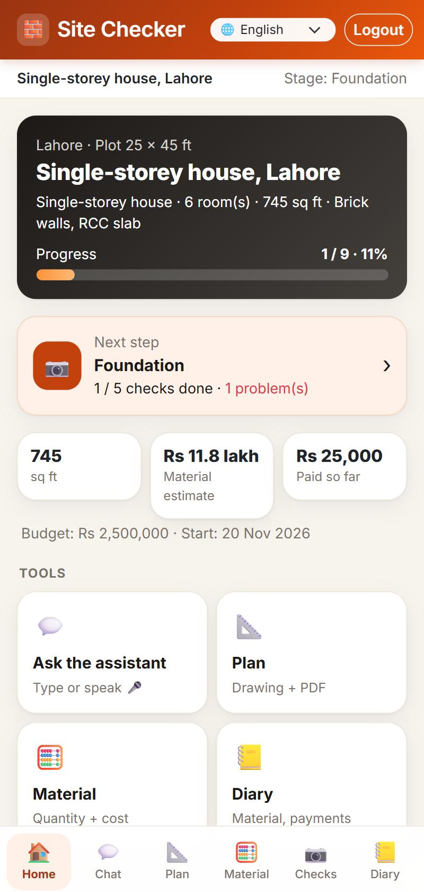
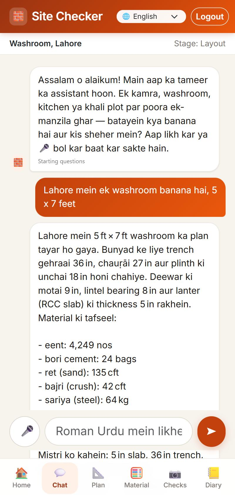
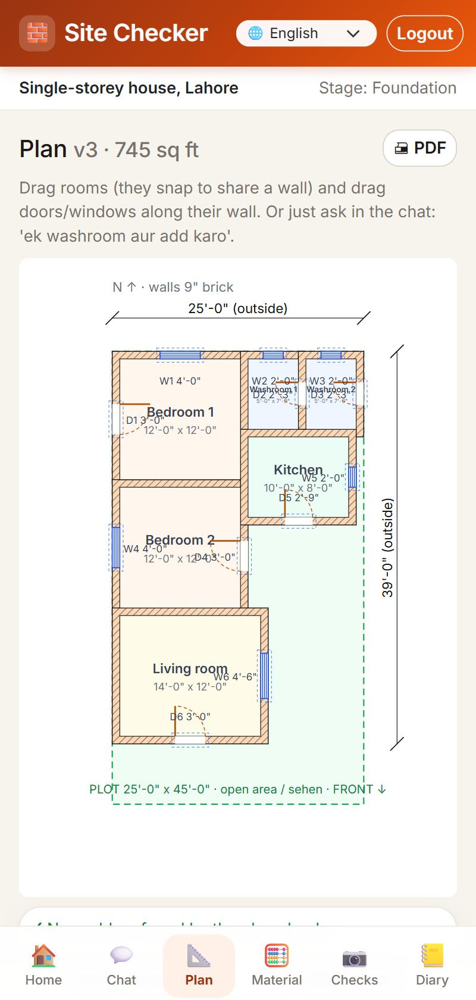
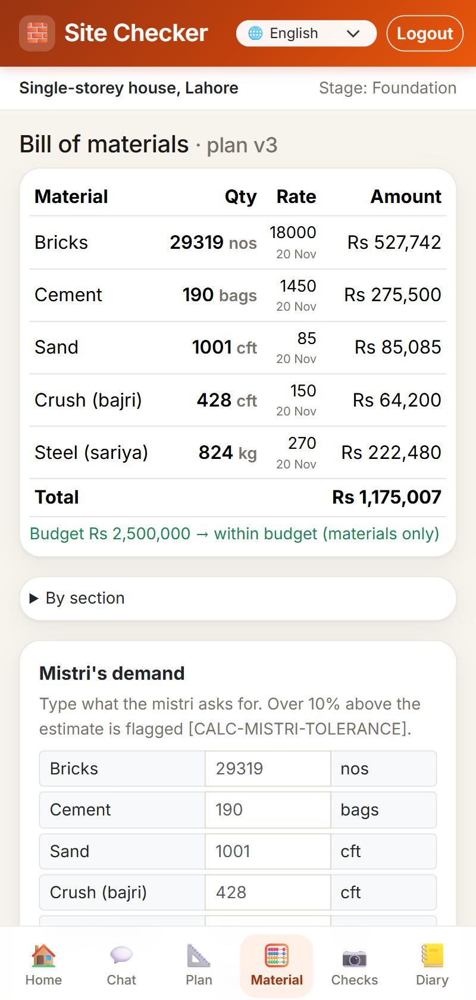
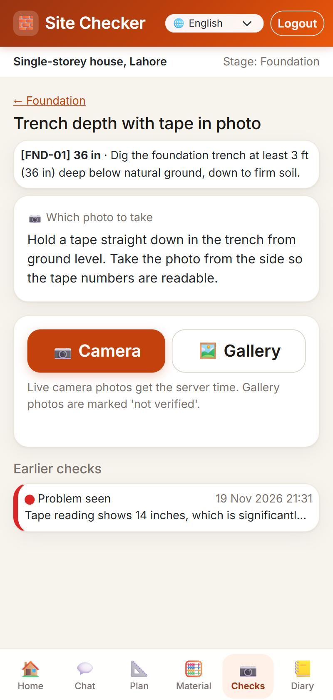
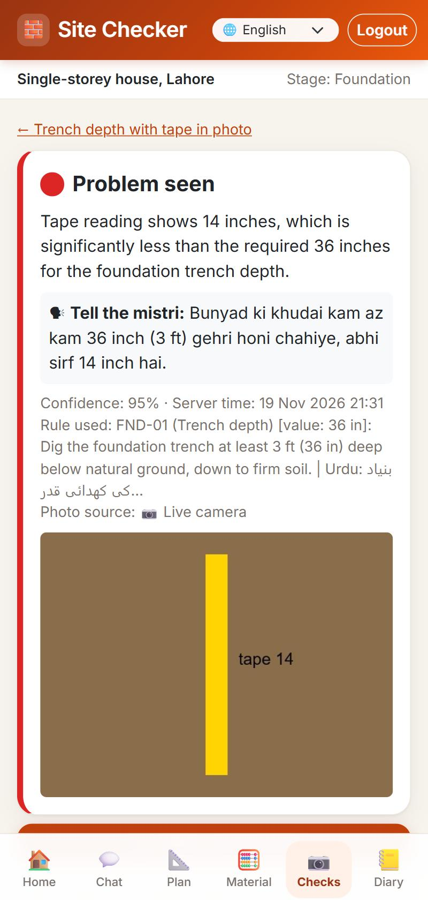
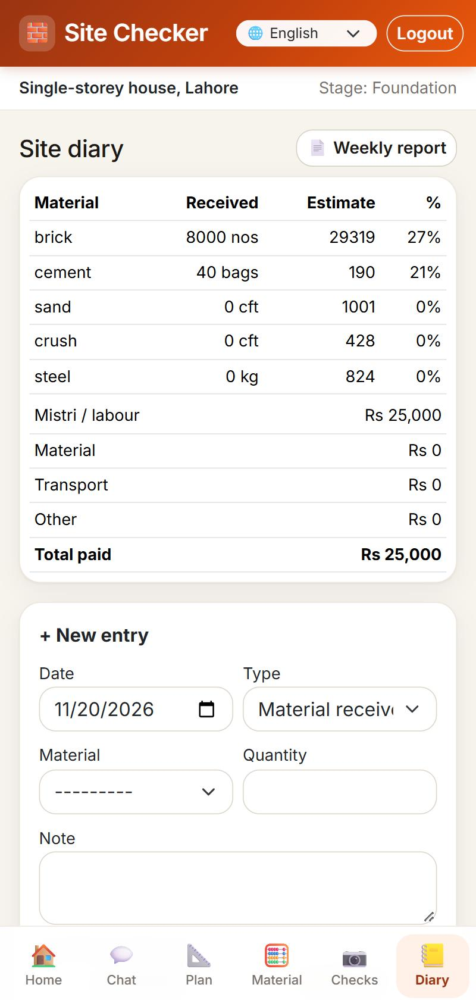
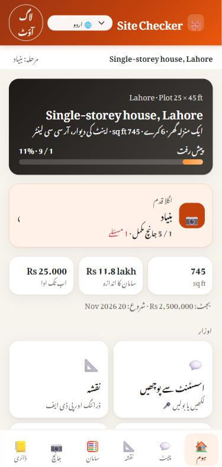

# 🧱 Site Checker — Construction Checker AI

**An AI site engineer in every homeowner's pocket.** Site Checker helps a normal person in Pakistan design and
build a small **single-storey building** — one room, a washroom, a kitchen, or a whole house on an empty plot —
know the right **material and cost**, and **check the mistri's work stage by stage**.
It talks in **Urdu, Roman Urdu or English**, by **typing or voice**, and an **AI agent** does the work through tools.

> **The app never says a structure is "safe".** It says what it checked and what it found.
> Anything bigger than one storey, a beam, a basement or a room span over 14 ft goes to an engineer.

<p align="center">
  
  
  
  
</p>
<p align="center">
  
  
  
  
</p>

---

## Contents

1. [The problem](#1-the-problem)
2. [The solution](#2-the-solution)
3. [Features](#3-features)
4. [How it works](#4-how-it-works)
5. [Tech stack](#5-tech-stack)
6. [Project structure](#6-project-structure)
7. [Run it locally](#7-run-it-locally)
8. [AI setup (Groq) and voice](#8-ai-setup-groq-and-voice)
9. [Languages](#9-languages)
10. [Safety design](#10-safety-design)
11. [Tests and evaluation](#11-tests-and-evaluation)
12. [Deploy](#12-deploy)
13. [Android app](#13-android-app)
14. [Limits and roadmap](#14-limits-and-roadmap)

---

## 1. The problem

Most small homes are built with **no plan, no numbers and no one checking the work**:

| Gap | What happens today |
|---|---|
| **No plan** | The owner tells the mistri "ek kamra, ek washroom" and the layout is decided on site, wall by wall. |
| **No quantities** | Nobody knows how many bricks, cement bags or kilos of steel are needed, so over-ordering and over-billing go unnoticed. |
| **No checks** | Trench depth, steel spacing and curing are hidden once covered. Engineers are rarely hired for a small build. |

The user is a homeowner with no engineering knowledge, who speaks Urdu or Roman Urdu, uses a low-cost Android
phone, and often has weak internet on site.

## 2. The solution

Site Checker is one phone-first web app (also packaged as an Android app) with five modules:

1. **Chat + voice agent** — say what you want to build; the agent asks what is missing and does the work.
2. **Plan drawing** — a to-scale drawing in feet and inches: rooms with shared walls, doors, windows, plot boundary, printable as PDF.
3. **Material calculator** — bricks, cement, sand, crush and steel with wastage, priced at today's rates, compared with what the mistri asks for.
4. **Camera check** — 9 stages, 32 checklist items. A live-camera photo (or gallery photo, marked "not verified"), a tape reading or the phone's tilt sensor is checked against the rule.
5. **Site diary** — material received and payments, totals against the estimate, a one-page weekly PDF report.

## 3. Features

- 🗣️ **Agentic AI** — 21 tools: set up the project, design or redesign the layout, add/resize/remove rooms, move doors and windows, check the plan, calculate materials, save rates, compare the mistri's demand, mark stages, write diary entries.
- 🎤 **Voice** — tap the mic, speak, it stops by itself when you go quiet; **hands-free mode** listens again after each spoken reply.
- 🏠 **Any small single-storey build** — 80 to 1,500 sq ft, up to 8 rooms; plot in feet, **marla** or **gaz**.
- 📐 **Auto-layout "designer"** — tries many arrangements and keeps the one with the fewest rule problems (shared walls, no thin gaps, washrooms on an outside wall, windows sized to the light rule).
- 🧮 **Exact quantities** — walls shared by two rooms counted once; matches a hand calculation in the tests.
- 📷 **Photo checks** — green / yellow / red with the rule used and one line to tell the mistri; low confidence is always yellow.
- 🌐 **Website language** — English, اردو (right-to-left), both side by side, or Roman Urdu; chat and voice languages chosen separately.
- 📶 **Works on weak internet** — offline photo queue (IndexedDB), cached app shell (service worker), photos shrunk on the phone.
- 🧾 **Rules table** — 100 rules with sources, editable by an engineer in the admin without code.
- 🔁 **Works without AI too** — fixed setup questions and answers straight from the Rules table when no key is set or the free quota runs out.

## 4. How it works

```
 Phone (browser / Android WebView)                Server (Django, Python)                     AI (Groq)
 ┌──────────────────────────────┐   HTTPS   ┌──────────────────────────────────┐   API   ┌──────────────────────────┐
 │ Pages: templates + Bootstrap │ ───────▶ │ 1. Scope gate (needs engineer?)  │ ──────▶ │ gpt-oss-120b  agent +     │
 │ SVG plan (plan.js)           │          │ 2. Load project facts + rules    │         │               tool calls  │
 │ Live camera + mic            │ ◀─────── │ 3. Agent loop with 21 tools      │ ◀────── │ qwen3.8-27b   photos +    │
 │ Offline queue (IndexedDB)    │          │ 4. Calculator / layout (Python)  │         │               backup      │
 │ Phone voice reads replies    │          │ 5. Validate, save, reply         │         │ whisper-large-v3 speech   │
 └──────────────────────────────┘          └──────────────────────────────────┘         └──────────────────────────┘
```

**One voice message:** the phone records → Groq Whisper turns it into text → the **scope gate** checks it → the
agent gets the project facts and its tools → it calls, for example, `setup_project` then `calculate_materials` →
our code checks the result against the Rules table and saves it → the reply comes back with buttons to the plan and
materials, and the phone reads it aloud.

**One photo check:** pick a checklist item → take a live photo (shrunk on the phone, or queued offline) → the server
loads the rule → the vision model returns fixed JSON (`status, reason, confidence, tell_mistri, photo_usable`) →
Pydantic validates it → green / yellow / red. Low confidence or an unusable photo becomes yellow with "take a new photo".

## 5. Tech stack

| Layer | Tool | Why |
|---|---|---|
| Backend | **Python + Django 5.2** | Pages, API, login and admin in one project |
| AI agent | **Groq `openai/gpt-oss-120b`** (OpenAI SDK, Groq base URL) | Fast tool calling; provider behind one file |
| Backup model | **Groq `qwen/qwen3.8-27b`** | Own daily quota; also reads photos (vision, JSON mode) |
| Voice | **Groq `whisper-large-v3`** + the phone's text-to-speech | Urdu speech to text; replies read aloud |
| Validation | **Pydantic** | Every photo reply must match a fixed schema |
| Rules | Rules table in the database + Django admin | Engineer edits values, no code |
| Calculator / layout | Pure Python (`calculator/calc.py`, `plans/geometry.py`, `plans/layout.py`) | Exact, testable, no AI inside |
| Front end | Django templates, Bootstrap 5, plain JS, SVG | Light pages for weak internet |
| Offline | Service worker + IndexedDB queue | Photos wait on the phone and upload later |
| Background jobs | Celery + Redis | Photo checks don't block the page (inline without Redis) |
| Database | SQLite (laptop) / PostgreSQL (server) | Free and reliable |
| Photo storage | Disk / S3-compatible via django-storages | One setting to switch |
| Hosting | Docker, Gunicorn, Nginx, HTTPS | One small server; the camera needs HTTPS |
| Android | Capacitor WebView | The same site as a Play Store app |
| Tests / CI | pytest + GitHub Actions | 165 tests on every push |

All AI calls live in **one file: [`core/ai_service.py`](core/ai_service.py)**. Changing model or provider means
changing that file or `.env`.

## 6. Project structure

```
config/          settings, URLs, Celery app
core/            ai_service.py (all AI calls), i18n.py (site languages), usage limits, template tags
accounts/        phone-number + password login, user language settings
projects/        Project, Rule, Rate, stages, checklist; scope gate; seed data (rules + checklists)
chatbot/         chat + voice views, agent tools (agent_tools.py), setup questions, rules-only fallback, evals
plans/           plan geometry, auto-layout designer, plan checks, editor + printable plan
calculator/      material calculator (pure Python) + estimates, rates, mistri comparison
checks/          camera checks: photo/measure/tilt, Celery task, photo source + EXIF date
diary/           site diary, totals, weekly report
templates/       all pages (English / Urdu / both / Roman Urdu)
static/          app.css, plan.js (SVG drawing), voice.js, camera.js, offline-queue.js, sw.js
evals/           chat_questions.json (30 in-scope + 10 out-of-scope)
android/         Capacitor wrapper and setup notes
deploy/          nginx.conf
docs/            screenshots
```

## 7. Run it locally

Needs Python 3.12+ (tested on 3.14).

```bash
python -m venv .venv
.venv\Scripts\activate            # Windows (macOS/Linux: source .venv/bin/activate)
pip install -r requirements.txt
copy .env.example .env            # macOS/Linux: cp .env.example .env
python manage.py migrate
python manage.py seed_v1          # loads the Rules table + stage checklists
python manage.py createsuperuser  # your phone number + password
python manage.py runserver
```

Open http://127.0.0.1:8000 — the admin (Rules, Rates, Checklist) is at http://127.0.0.1:8000/admin/.

Without an AI key everything still works: fixed starting questions set up the project, the chat answers from the
Rules table, voice is hidden, and photo checks are saved and marked yellow for manual review.
Without `REDIS_URL`, Celery tasks run inline.

> On Windows, if activation is blocked: `Set-ExecutionPolicy -Scope CurrentUser RemoteSigned`, or call
> `.venv\Scripts\python manage.py runserver` directly.

## 8. AI setup (Groq) and voice

1. Get a key at https://console.groq.com/keys.
2. Put it in `.env` as `GROQ_API_KEY=...` (**never commit `.env`** — it is git-ignored).
3. Restart the server. The chat now shows 🎤 and the hands-free toggle.

| Setting | Default | Notes |
|---|---|---|
| `GROQ_MODEL_CHAT` | `openai/gpt-oss-120b` | The agent. |
| `GROQ_MODEL_CHAT_FALLBACK` | `qwen/qwen3.8-27b` | Used automatically when the main model's daily quota is used up. |
| `GROQ_MODEL_VISION` | `qwen/qwen3.8-27b` | Photo checks. A **preview** model on Groq: measure accuracy with `eval_photos` first. |
| `GROQ_MODEL_STT` | `whisper-large-v3` | Speech to text; told the speaking language so it never guesses. |
| `AI_DAILY_LIMIT_PER_USER` | `60` | AI calls per user per day. |
| `AI_MAX_WAIT_SECONDS` | `30` | Longest rate-limit wait inside one reply. |

**Free tier limits:** Groq's free tier allows about 8,000 tokens a minute and 200,000 a day per model. The prompt is
kept small (~2,300 tokens), setup takes one tool call, and when a quota runs out the app says so with the time it
comes back, switches to the backup model, and keeps answering from the Rules table.

**Voice:** the phone records with `MediaRecorder`; the server transcribes with Whisper; replies are spoken by the
phone's own voice (Groq has no Urdu voice) — install **Urdu** in *Google Speech Services* for the best sound.
The microphone and live camera need **HTTPS** (or localhost).

OpenAI also works: set `OPENAI_API_KEY` (and `AI_PROVIDER=openai` if both keys are set).

## 9. Languages

- **Website language** (🌐 menu in the header): English, اردو (whole site right-to-left), English + اردو side by side, or Roman Urdu. Saved on the account; translations live in [`core/i18n.py`](core/i18n.py).
- **Chat language** (under the message box): ✍️ typing — Roman Urdu, اردو or English; 🎤 speaking — اردو / Roman Urdu or English. Replies follow these choices.

## 10. Safety design

1. **Scope gate first** ([`projects/scope.py`](projects/scope.py)) — second storey, beams/columns, basements, cracks in old buildings, commercial buildings, "is it safe?", weak soil, balconies, a room span over 14 ft, more than 1,500 sq ft or 8 rooms → "this needs an engineer" with the reason and rule ID.
2. **Rules live in the database** — the AI quotes rules by ID (e.g. `[FND-01]`); key values are in its prompt so it never guesses.
3. **Numbers come from code** — quantities, layouts and checks are Python tools; the model only chooses which tool to call. Tools refuse plans that break a scope rule.
4. **Photo replies are a fixed JSON**, validated by Pydantic; a wrong green is the worst mistake, so anything uncertain is yellow.
5. **Gallery photos are marked "not verified"**; if the photo's own date is old, the result warns it may be an old photo. Live-camera photos carry the server time.
6. **Never "safe"** — any reply that sounds like a certificate gets a note that the app does not certify safety.

**Before launch:** a registered engineer must review every rule (admin → Rules → tick *engineer reviewed*) against
**BCP 2021**. All seeded rules are marked *PENDING ENGINEER REVIEW*.

## 11. Tests and evaluation

```bash
pytest -q                                   # 165 tests, no real AI is called
python manage.py eval_chat --rules          # 30 rule questions + 10 out-of-scope (rules-only mode)
python manage.py eval_chat                  # the same with the live AI agent
python manage.py eval_photos                # wrong-green rate on labelled photos in evals/photos/<ITEM>/good|bad/
```

Current results: **165 tests pass** · rules-only chat eval **30/30** cite the right rule and **10/10** out-of-scope
say "needs an engineer" · layout benchmark **0 plan problems** on 8 typical briefs · Whisper transcription about
**2 s**. On Windows set `PYTHONIOENCODING=utf-8` before the eval commands.

## 12. Deploy

```bash
cp .env.example .env    # DJANGO_DEBUG=false, DJANGO_ALLOWED_HOSTS, POSTGRES_*, REDIS_URL=redis://redis:6379/0, GROQ_API_KEY
# edit deploy/nginx.conf with your domain and get a Let's Encrypt certificate (certbot)
docker compose up -d --build
docker compose exec web python manage.py migrate
docker compose exec web python manage.py seed_v1
docker compose exec web python manage.py createsuperuser
```

Photos in production: `USE_S3=true` and the `AWS_*` settings (any S3-compatible storage).
Raise `STATIC_VERSION` on every release so phones load the new CSS/JS.

## 13. Android app

The Android app is the live site inside a Capacitor WebView — see [`android/README.md`](android/README.md)
(camera, microphone and internet permissions, back button, building the APK, Play Store notes).
The site is also installable from Chrome (menu → *Install app*).

## 14. Limits and roadmap

**Version 1 (this repo):** single-storey brick buildings with an RCC slab, up to 8 rooms and 1,500 sq ft; plans are
setting-out drawings, not structural designs.

**Before launch:** engineer review of the Rules table · 100+ labelled real site photos to measure the wrong-green
rate · HTTPS server + Android APK · pilot on one real site.

**Version 2:** concrete cube-test tracker · engineer review queue with sign-off and hold points · library of
engineer-signed designs · curing reminders · optional slab temperature sensor.

---

Built with Django and Groq. Rules are a starting point from general practice in Pakistan and must be reviewed by a
registered engineer before real use.
